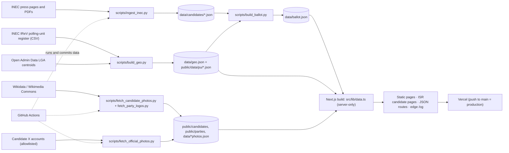

# AGENTS.md: Know Your Ballot · Nigeria 2027

Civic, non-partisan site that helps any Nigerian voter find every candidate on their 2027 ballot (President, Senate, House of Representatives, Governor, State House of Assembly) by state, LGA, ward, polling unit code or location, and read sourced information about them.

- **Repo:** https://github.com/Ay7ot/knowyourballot-ng (default branch `main`)
- **Live:** https://knowyourballot-ng.vercel.app
- **Election dates:** 16 Jan 2027 (Presidential & National Assembly), 6 Feb 2027 (Governorship & State Assembly), defined in `ELECTIONS` in `src/lib/data.ts`.

Current dataset (`data/ballot.json`, generated 2026-11-06): **15,137 candidates, 1,489 races, 991 State Assembly constituencies, 0 unmatched rows**; geography: 37 states/FCT, 774 LGAs, 8,809 wards, 109 senatorial districts, 360 federal constituencies.

---

## Non-negotiable rules

1. **Every fact needs a source.** Candidate rows come only from INEC documents; each candidate keeps `source.url` and `source.page`. Manifestos and pledges link to their source. Nothing is typed in by hand without a citation.
2. **Non-partisan, no editorialising.** No religion, no unsourced claims, no commentary on candidates. Candidates appear in INEC's order and every party gets the same plain treatment.
3. **Photos must be verified as the right person.** A wrong face is worse than no photo. Do not loosen the matching rules in `scripts/fetch_candidate_photos.py` without a concrete reason and a review of `data/photo_report.json`.
4. **Pushing to `main` deploys production.** Treat every push as a production deploy. Run `npm run typecheck` and `npm run build` first, then check the live page.
5. **Corrections are human-reviewed.** Users send corrections through prefilled GitHub issues (`src/lib/site.ts`). Do not auto-merge corrections into data.
6. **Keep client JavaScript small.** Performance is a product requirement (Lighthouse 100 desktop, 96 to 98 mobile performance, limited by Next/React's shared JS).

---

## Stack

| Layer              | Choice                                                                                     |
| ------------------ | ------------------------------------------------------------------------------------------ |
| Framework          | Next.js 15.5 (App Router), React 19, TypeScript 5.9 (`strict: true`)                       |
| Styling            | Tailwind CSS v4 via `@tailwindcss/postcss`, CSS-first tokens in `src/app/globals.css`      |
| Search             | Fuse.js in the browser over a generated `/search-index.json`                               |
| Maps               | Local SVG state boundaries (geoBoundaries / GRID3) and LGA centroids; no tile service      |
| Fonts              | Self-hosted, subsetted Archivo / Atkinson Hyperlegible Next / IBM Plex Mono in `src/fonts` |
| Data pipeline      | Python 3.12 scripts (`pdfplumber` 0.11.10, `Pillow` 13.0.0), run by GitHub Actions         |
| Quality            | Biome 2.6 for lint and format; `tsc --noEmit`; Node test runner and pytest                 |
| CI                 | GitHub Actions: audit, check, typecheck, tests, build and smoke                            |
| Hosting            | Vercel (Git integration); Vercel Blob for failed-search analytics                          |
| Runtime data store | None. JSON files committed to the repo are the data layer                                  |

---

## Architecture



### Data flow

1. **Python pipeline** downloads and parses INEC PDFs, builds the electoral map, and joins rows into `data/ballot.json`. See `scripts/` and `.github/workflows/`.
2. **Build-time import:** `src/lib/data.ts` imports `ballot.json`, `geo.json`, `parties.json`, `platforms.json` and photo JSON with `import "server-only"`. It builds `Map`s once and exposes getters (`getRace`, `getCandidate`, `ballotForLga`, `stats`, `toTray`, `candidatePhoto`, `platformFor`, `quickEntries`).
3. **Server components** call those getters and pass trimmed props to client components.
4. **Client components** (`"use client"`) handle interaction only: ballot tray, picks/compare, search, header menu, share, countdown. They never import `src/lib/data.ts`.
5. **Generated routes** emit the search index and LGA points as JSON for the browser.

### Rendering strategy

| Route                                                                     | Strategy                                                                                                                                 |
| ------------------------------------------------------------------------- | ---------------------------------------------------------------------------------------------------------------------------------------- |
| `/`, `/guide`, `/who-decides`, `/economy`, `/data`, `/promises`, `/state` | Static                                                                                                                                   |
| `/state/[state]`, `/state/[state]/[lga]`                                  | Fully static, `dynamicParams = false`, `generateStaticParams` over 37 states and 774 LGAs                                                |
| `/race/[id]`                                                              | Fully static, `dynamicParams = false`, 1,489 races                                                                                       |
| `/candidate/[id]`                                                         | President and Governor pages prerendered; the rest render on first request and are cached (`dynamicParams = true`, `revalidate = 86400`) |
| `/search-index.json`, `/lga-points.json`                                  | `dynamic = "force-static"` JSON routes with cache headers                                                                                |
| `/og`                                                                     | Edge runtime (`src/app/og/route.tsx`), TTFs live beside the route                                                                        |
| `/api/search-miss`                                                        | Node runtime; `POST` writes sanitised query text to Vercel Blob, `GET ?key=…` returns a 30-day report                                    |

`next.config.ts`: `poweredByHeader: false`, `experimental.inlineCss`, and a one-day `Cache-Control` for `/data/:path*`.

---

## Repository layout

```
src/app/            App Router routes (see table above) + globals.css + fonts
src/components/     UI and client behaviour: FindBallot, GeoMap, BallotDesk, LgaFilter,
                    MyBallot, BallotTray, RaceSheet, Promises, SiteHeader, controls, picks, ui, ...
src/lib/            data.ts (server-only data access), types.ts, seo.ts,
                    civics.ts (glossary/issues), economy.ts (hand-checked figures), site.ts, gutter.ts
src/fonts/          subsetted WOFF2 files
data/               committed data (generated and hand-maintained; see below)
public/             candidates/*.webp, parties/*.webp, data/pu/*.json
scripts/            Python data pipeline + smoke.sh + snapshot_ids.mjs
tests/              data-contract.test.mjs, python/test_*.py, fixtures/data-ids.json
docs/               data.md, testing.md, runbook.md, labels.md
.github/workflows/  ci.yml, ingest.yml, media.yml, official-photos.yml, photo-options.yml
biome.json          lint and format config
pytest.ini          Python test paths
requirements*.txt   pinned pipeline and dev packages
```

Root documents: `README.md`, `HANDOFF.md`, `SECURITY.md`, `CONTRIBUTING.md`, `CODE_OF_CONDUCT.md`, `CHANGELOG.md`, `.env.example`.

### Generated vs hand-maintained data

**Generated: do not hand-edit; change the source or the script and rerun:**

- `data/candidates/*.json`, `data/candidates/_report.json` (ingest)
- `data/geo.json`, `public/data/pu/*.json` (build_geo)
- `data/nigeria-map.json` (state boundary paths, `scripts/build_map.mjs`)
- `data/ballot.json` (build_ballot)
- `data/party_logos.json`, `data/candidate_photos.json`, `data/photo_report.json`, `data/official_photos.json`
- `public/candidates/*.webp`, `public/parties/*.webp`

**Hand-maintained inputs:**

- `data/sources.json`: INEC press pages to scrape
- `data/official_handles.json`: candidate-id → X handle, with a `why`
- `data/platforms.json`: sourced manifestos, pledges, party platforms
- `data/photo_rejects.json`, `data/photo_confirms.json`: human photo decisions
- `data/photo_overrides.json`: optional, present as `{}`
- `data/parties.json`: INEC's 22 parties
- `src/lib/economy.ts`: hand-checked figures; bump `ECONOMY_CHECKED` when a figure changes

---

## Data model and ID conventions

Types: `src/lib/types.ts`.

- **State:** `code` is INEC's numeric string (`"01"`…`"37"`), plus `slug`, `name`, `short`, `zone`, `governorship`, `assembly`.
- **LGA:** `id = "<stateCode>-<NN>"` e.g. `"01-01"`; `slug`; `senatorial` (district id); `federal` (array of district ids).
- **Ward:** `id = "<stateCode>-<lgaNN>-<wardNN>"` e.g. `"01-01-01"`; links use `w.id.split("-")[2]`.
- **District:** `id = "<stateSlug>--<district-slug>"` e.g. `"abia--aba-north"`.
- **Race:** `president`; `gov--<stateSlug>`; `sen--<districtId>`; `rep--<districtId>`; `sha--<assemblyConstituencyId>`.
- **Candidate:** `<raceId>--<partyCode>` e.g. `president--ndc`, `gov--delta--apc`, `sen--ogun--ogun-east--apc`, `sha--abia--aba-north--a`. A numeric suffix (`-2`, `-3`) is appended if an id collides. Running mates are nested in `Candidate.runningMate`; their photos are keyed `<candidateId>--mate`.
- **Candidate `source`:** `{ url, page }` pointing at the INEC PDF: never drop this.
- **`unmatched`:** rows that could not be placed on the map stay in `ballot.json` and appear on `/data`. Do not silently discard them.

IDs are derived from names and slugs, so a renamed constituency can change IDs and break URLs. If you change slug/matching logic, check redirects and existing links.

---

## Commands

```sh
npm ci                 # install
npm run dev            # http://localhost:3000 (3100 is used by another local app)
npm run check          # Biome formatting and lint
npm run format         # write formatting fixes
npm run audit          # npm audit, fails on any vulnerability
npm run typecheck      # tsc --noEmit
npm test               # data contract and ID snapshot
npm run build          # full production build (2,777 static pages); about a minute
npm run smoke          # start the built server and check routes, headers and API guards
npm run snapshot:ids   # update the stable-ID snapshot after a reviewed rename
npm run start          # serve the production build
```

Biome replaced `next lint`. The old `next lint` command is deprecated and needs an ESLint config, so do not use it. `npm run check` is the formatting and lint gate.

### Data pipeline

Use Python 3.12 through `uv`. The system Python is 3.9 and does not have the pipeline packages.

```sh
uv venv --python 3.12
uv pip install -r requirements-dev.txt
uv run pytest -q
```

```sh
uv run python scripts/build_geo.py                  # data/raw -> data/geo.json + public/data/pu/*.json
uv run python scripts/ingest_inec.py                # INEC PDFs -> data/candidates/*.json (+ _report.json)
uv run python scripts/build_ballot.py               # candidates + geo -> data/ballot.json
uv run python scripts/fetch_party_logos.py          # INEC party pages -> public/parties/*.webp
uv run python scripts/fetch_candidate_photos.py president,governor,senate
uv run python scripts/fetch_official_photos.py      # X profile photos for data/official_handles.json
uv run python scripts/photo_options.py <id> "<Commons category>"   # review thumbnails, never main
uv run python scripts/subset_fonts.py               # rebuild fonts if they change
```

Workflows:

- `ingest.yml`: daily 05:00 UTC, plus on `data/sources.json` / ingest script changes. Downloads, parses, rebuilds `ballot.json`, commits to `main`.
- `media.yml`: Mondays (or manual with `offices`), party logos and Commons photos; up to 5 hours.
- `official-photos.yml`: on `data/official_handles.json` or script changes.
- `photo-options.yml`: manual; pushes review images to the `photo-review` branch, never `main`.

All data workflows share concurrency group `ingest` and commit back to `main`, which triggers a deploy. Pull before pushing if a workflow is running.

---

## Conventions

- **TypeScript strict.** No `any` unless unavoidable; prefer the types in `src/lib/types.ts`.
- **Server by default.** Add `"use client"` only when a component needs state, effects or browser APIs. Keep data access in server components or routes.
- **Data access goes through `src/lib/data.ts`.** Do not import `data/*.json` directly in components.
- **Aliases:** `@/*` → `src/*`, `@data/*` → `data/*`.
- **SEO:** every page uses `pageMeta()` from `src/lib/seo.ts`. Next replaces (does not merge) `openGraph` and `twitter` from the layout, so always set the full metadata. OG images come from `/og` query parameters.
- **Styling:** Tailwind utilities plus semantic CSS variables (`--paper`, `--sheet`, `--ink`, `--muted`, `--rule`, `--green`, `--violet`, `--amber-soft`). Do not hardcode hex colours in components; add a token in `globals.css` instead. Dark mode is handled by `prefers-color-scheme` and `[data-theme]`.
- **Design language:** the voter's ballot paper. Archivo display headers, Atkinson body, IBM Plex Mono for codes/numbers; square party boxes; violet reserved for the voter's own marks. Respect the existing visual system.
- **Accessibility:** `lang="en-NG"`, skip link, one visible focus ring, `aria-label` on nav landmarks, reduced-motion guard, print styles hide chrome. Preserve these when editing layout.
- **Copy:** plain English for first-time voters, no partisan framing. Glossaries and office explanations live in `src/lib/civics.ts` and `OFFICE_INFO` in `src/lib/data.ts`.
- **Images:** candidate photos are plain `` because files are pre-sized in `public/`; there is no `next/image` use. Keep explicit `width`/`height` and alt text.
- **Client props:** pass slim shapes (`toTray()`), not full candidate records, to client components.
- **Maps:** `GeoMap` renders local SVG state paths from `data/nigeria-map.json` plus LGA dots. Regenerate with `node scripts/build_map.mjs /tmp/nga-states.geojson`; credit geoBoundaries / GRID3, CC BY 4.0. Do not add a tile service without a privacy and performance review.

---

## Testing strategy

Deterministic layers exist. Run all of them before a pull request:

| Command                                | Covers                                                                                          |
| -------------------------------------- | ----------------------------------------------------------------------------------------------- |
| `npm run audit`                        | npm vulnerabilities at any severity                                                             |
| `npm run check`                        | Biome formatting and lint                                                                       |
| `npm run typecheck`                    | TypeScript strict compile                                                                       |
| `npm test`                             | Data contract, foreign keys, sources, photo files, candidate IDs, maps and polling unit parsing |
| `npm run build`                        | Every route and static page                                                                     |
| `npm run smoke`                        | Built server, key routes, security headers and API guards                                       |
| `uv run pytest -q`                     | Python pipeline helpers                                                                         |
| `uv run pip-audit -r requirements.txt` | Python dependencies, on the Linux resolution                                                    |

Test files:

- `tests/data-contract.test.mjs`: Node test runner; data invariants and the ID snapshot in `tests/fixtures/data-ids.json`.
- `tests/python/test_build_ballot.py`: party-code normalisation, slug/title helpers, qualification levels and State Assembly matching.
- `scripts/smoke.sh`: production server smoke test, including `/api/search-miss` guards.

When a reviewed rename removes a stable ID, add a redirect, then run `npm run snapshot:ids`. Do not update the snapshot to make a failing test pass without reviewing the removed IDs.

Not covered yet: browser end-to-end for search and picks, automated accessibility audits, performance budgets in CI, and photo matcher unit tests.

---

## Deployment and environment

- Vercel is connected to GitHub. **Push to `main` → production deploy**; other branches get preview URLs. There is no `vercel.json`.
- Before pushing: `npm run audit && npm run check && npm run typecheck && npm test && npm run build && npm run smoke`. After pushing: check the live page.
- CI in `.github/workflows/ci.yml` runs audit, format/lint, typecheck, tests, build and smoke on every pull request and push to `main`. GitHub Actions are pinned to commit SHAs, and checkouts do not persist credentials.
- Data workflows run `npm run test:data` before committing, so a broken join or missing asset stops the commit.
- Env vars (none needed for local dev):
  - `BLOB_READ_WRITE_TOKEN`: Vercel Blob store `kyb-search-misses`; without it `/api/search-miss` returns 204 and stores nothing. `vercel env pull .env.local` needs the Vercel CLI (not installed here).
  - `SEARCH_REPORT_KEY`: **not set yet**. Without it, `GET /api/search-miss` returns 404 (fail closed).
  - `NEXT_PUBLIC_SITE_URL`: optional, defaults to the Vercel URL.
- `gh` is installed; the Vercel CLI is not.

---

## Security and sensitive surfaces

- `/api/search-miss` `POST` is unauthenticated by design. It rejects browser cross-origin requests when `Origin` is present (403), non-JSON bodies (415), bodies over 512 bytes (413) and more than 30 requests per 10 minutes per instance (429). It sanitises input to 60 characters, records only the query and day (no IP, cookie or device), and writes to private Blob storage. The limiter is in memory per serverless instance, not a global quota.
- `GET /api/search-miss` requires `SEARCH_REPORT_KEY`, returns 404 when unset, accepts `Authorization: Bearer` or `?key=`, and compares the key with `timingSafeEqual`.
- `next.config.ts` sets `X-Content-Type-Options`, `Referrer-Policy`, `X-Frame-Options`, `Permissions-Policy`, HSTS and, in production, a CSP. The CSP allows inline scripts and styles because Next injects both; everything else is locked to self.
- Python scripts fetch from INEC, Wikidata, Wikimedia Commons and X. Keep timeouts, user agent and allowlists; never fetch arbitrary URLs from user input.
- No secrets belong in the repo or in data JSON.
- Candidate photos: Commons images carry licence and attribution in `data/candidate_photos.json` and must keep their credit. Official X photos are **not freely licensed**; they are shown with a credit and a removal link. Do not add official photos without a verified account and a `why`.
- `poweredByHeader` is off. Treat new security headers or CSP changes as production changes and verify them with `npm run smoke`.

---

## Documentation map

- `README.md`: public overview, commands and links.
- `HANDOFF.md`: detailed operating brief: current numbers, pipelines, photo rules, deploy flow, open decisions. **Read this before large work.**
- `AGENTS.md`: this file: agent-facing rules and architecture.
- `SECURITY.md`: private vulnerability reporting and scope.
- `CONTRIBUTING.md`: setup, checks, code style, data rules and pull request checklist.
- `CODE_OF_CONDUCT.md`: community standards.
- `CHANGELOG.md`: notable changes.
- `docs/data.md`: data dictionary, ID conventions and invariants.
- `docs/testing.md`: test layers, snapshots and CI.
- `docs/runbook.md`: ingest, deploy, photo, search and dependency failure procedures.
- `docs/labels.md`: labels used by the issue templates.

---

## Known gaps and risks

- **Data workflows still commit to `main`.** They now validate with `npm run test:data` before committing, but there is no human review or PR gate. A bad but structurally valid parse can still deploy.
- **Large JSON in Git:** `data/ballot.json` ~6.5 MB, `data/candidates/assembly.json` ~3.9 MB, `public/data/pu` ~7.2 MB. Builds and clones are heavy; think before adding more committed artifacts.
- **ID stability:** names and slugs drive IDs. The data contract test fails when a stable ID is removed, and renames still need a redirect.
- **Rate limiting is per serverless instance.** The in-memory limiter is not a global quota. Use Vercel WAF or a shared store if abuse becomes a cost problem.
- **No browser end-to-end tests, automated accessibility audits or performance budgets in CI.** The search input uses its visible label as the accessible name, but manual checks still matter.
- **Python audit uses the Linux resolution.** macOS x86_64 has no wheel for `cryptography` 49+, so local dev pins 48.0.1 while CI audits 50.0.2.
- **Coverage gaps:** some INEC lists are unpublished (e.g. Borno State Assembly at last check); `data/candidates/_report.json` and `/data` show failures.
- **No `LICENSE`.** The repository has no reuse terms yet.
- **Single maintainer.** Contributor docs and CI reduce the bus factor but do not remove it.
- **Official X photos beyond Peter Obi** remain a product and licensing decision.
- **`data/photo_overrides.json` is present as `{}`.** The media workflow trigger is live; add entries only after a human review.
- **Map boundaries are simplified.** They are for orientation, not survey-grade use. Four Imo LGAs have no centroid, so they appear in the list but not as map dots.
- **Observability is limited** to Vercel logs, GitHub Actions logs and the `/data` page. There is no error tracking or alerting.

---

## Working agreement for agents

- Inspect the repo, `HANDOFF.md` and the relevant data before asking questions. Ask only for product, editorial or business judgment.
- Do not modify generated data by hand. Change scripts or hand-maintained inputs, then rerun the pipeline.
- Do not push to `main` or deploy without explicit approval; a push is a production action.
- Do not loosen sourcing, photo-matching or non-partisan rules to make a page look fuller.
- Use Biome for formatting and lint: `npm run check`, or `npm run format` to write fixes.
- Before reporting a change as done, run `npm run audit`, `npm run check`, `npm run typecheck`, `npm test`, `npm run build` and `npm run smoke`, plus `uv run pytest -q` for pipeline changes. Report the exact commands and their output.
- If a change reveals an architectural problem (e.g. ID instability, data contract breakage), stop and report rather than silently redesigning.
- Keep changes small and verifiable.
